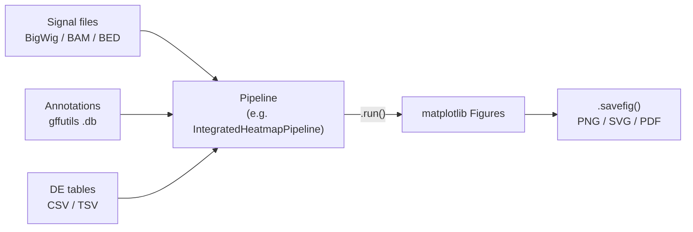

# Pyntegrate

**Integrative analysis of high-throughput sequencing data.**

Pyntegrate is a Python library for genomic data analysis, built on the foundation of [metaseq](https://github.com/daler/metaseq), created by Ryan Dale. It extends that foundation to analyze and cross-compare a wider variety of data types (ChIP-seq, RNA-seq, and DNase-seq/ATAC-seq) through a single, consistent API, and turns each common analysis into a one-call pipeline that returns publication-ready `matplotlib` figures.

[:material-download: Install Pyntegrate](installation.md){ .md-button .md-button--primary }
[:material-rocket-launch: Getting Started](getting_started.md){ .md-button }
[:material-image-multiple: Examples](examples.md){ .md-button }

---

## Why Pyntegrate?

Integrating several sequencing assays usually means juggling a different tool, file format, and plotting script for each one. Pyntegrate brings them under one roof:

<div class="grid cards" markdown>

-   :material-set-merge:{ .lg .middle } **Multi-omics integration**

    ---

    Combine ChIP-seq signal, ATAC-seq accessibility, and RNA-seq differential expression in the same analysis: split heatmaps by expression status, correlate log2 fold changes across assays, or group genes into ATAC/RNA quadrants.

-   :material-pipe:{ .lg .middle } **One-call pipelines**

    ---

    Each analysis is a pipeline class: pass file paths and parameters, call `.run()`, and get back ready-to-save figures. No separate loading, binning, or plotting step.

-   :material-chart-areaspline:{ .lg .middle } **Rich visualization**

    ---

    Heatmaps, meta-gene profiles, dual-axis overlays, volcano plots, decile boxplots, violin plots, hexbin correlations, and circos plots out of the box.

-   :material-file-multiple:{ .lg .middle } **Format-agnostic signal**

    ---

    A uniform interface to read BigWig, BAM, BigBed, BED, and NarrowPeak files, plus DESeq2/edgeR-style result tables, with CPM normalization handled for you.

-   :material-dna:{ .lg .middle } **Gene and peak annotation**

    ---

    Classify genomic regions (promoter, intergenic, ...) from interval data and, optionally, call and annotate peaks through [HOMER](http://homer.ucsd.edu/homer/).

-   :material-code-braces:{ .lg .middle } **Low-level access when you need it**

    ---

    Every pipeline is built from public building blocks (`SignalArrayGenerator`, `Plotting`, `Filtering`, ...) that you can call directly for custom workflows.

</div>

## Supported Data Types

| Data type | Typical input | What Pyntegrate does with it |
|---|---|---|
| **ChIP-seq** | BigWig / BAM | Signal extraction around TSS, IP − INPUT subtraction, heatmaps, profiles, log2FC correlations |
| **RNA-seq** | CSV/TSV (DESeq2-style) | Differential-expression parsing, volcano plots, decile and violin analysis, up/down gene splits |
| **DNase-seq / ATAC-seq** | BigWig / BAM / CSV | Accessibility signal extraction, category heatmaps, overlay profiles, knockdown correlations |

### Supported file formats

| Format | Support level |
|---|---|
| `bigwig`, `bam` | Full functionality, including read counting and signal extraction |
| `bed`, `bigbed`, `narrowPeak`, `gff`, `gtf`, `vcf` | Most functionality, but no read counting |
| `csv` / `tsv` | Full functionality for differential-expression tables (RNA-seq, ATAC-seq, ChIP-seq log2FC) |
| gffutils `.db` | Gene annotation database used to locate TSSs and gene bodies |

## How It Works



1. **Point a pipeline at your files.** Signal tracks, a gene annotation database, and (where relevant) differential-expression tables.
2. **Call `.run()`.** The pipeline reads the files, normalizes signal, builds binned arrays around TSSs or gene bodies, merges in expression or accessibility status, and draws the plots.
3. **Save or tweak the figures.** You get standard `matplotlib.figure.Figure` objects, so anything `matplotlib` can do still applies.

## A 30-second Example

Compare ChIP-seq IP vs. INPUT signal around every annotated TSS:

```python
from Pyntegrate.pipelines import PeakHeatmapPipeline

pipe = PeakHeatmapPipeline(
    db_path="annotations.gtf.db",   # gffutils FeatureDB
    ip_path="ip_signal.bw",
    input_path="input_signal.bw",
    genome="mm10",
    window=(-1000, 1000),
    bins=100,
)
figs = pipe.run()   # dict of matplotlib Figures

figs["profile"].savefig("profile.png", dpi=300)
figs["heatmap_sorted_mean"].savefig("heatmap.png", dpi=300)
```

The [Getting Started](getting_started.md) guide walks through this and the RNA-seq / ATAC-seq integration pipelines step by step.

## Available Pipelines

All pipelines live in [`Pyntegrate.pipelines`](api/pipelines.md) and follow the same *instantiate → `.run()` → figures* pattern.

| Category | Pipeline | Output |
|---|---|---|
| **Signal around TSS** | `PeakHeatmapPipeline` | IP − INPUT profile and heatmaps (unsorted, sorted by mean, sorted by max) |
| | `CategoryHeatmapPipeline` | Signal heatmaps split by genomic category |
| | `GeneScaleRegionsProfilePipeline` | Meta-profile over scaled gene bodies |
| **Multi-omics integration** | `IntegratedHeatmapPipeline` | Signal heatmap and profile split by RNA-seq or ATAC-seq up/down status |
| | `OverlayProfilePipeline` | Dual-axis average-profile overlay (e.g. ChIP vs. ATAC) |
| | `GeneGroupProfilePipeline` | Average signal profile split by ATAC/RNA log2FC quadrants |
| | `MultiSignalComparisonPipeline` | Multi-modal log2FC scatter plots |
| | `CircPlotPipeline` | Circos plot comparing changes across several signals |
| **Differential analysis** | `VolcanoPipeline` | Volcano plot from differential-expression results |
| | `RNAViolinPipeline` | RNA expression violins with significance overlay |
| | `DecilePipeline` | Signal decile boxplot with expression overlay (signal files + gene DB) |
| | `DecileScatterPipeline` | CSV-only decile analysis with flexible column selection |
| **Correlations** | `ChIPCategoryCorrelationPipeline` | Hexbin ChIP-seq correlation filtered by category |
| | `RNAKnockdownCorrelationPipeline` | Hexbin RNA-seq correlation for significant knockdown genes |
| | `ATACKnockdownCorrelationPipeline` | Hexbin ATAC-seq correlation for significant knockdown peaks |

## Gallery

A few of the figures produced by the [example scripts](examples.md):

<div class="grid" markdown>


*Meta-gene profile (`GeneScaleRegionsProfilePipeline`)*


*ChIP-seq heatmap split by RNA-seq status (`IntegratedHeatmapPipeline`)*


*ChIP-seq / ATAC-seq overlay (`OverlayProfilePipeline`)*


*Volcano plot (`VolcanoPipeline`)*


*RNA-seq violins (`RNAViolinPipeline`)*


*Multi-signal circos plot (`CircPlotPipeline`)*

</div>

[:material-image-multiple: See the full gallery](examples.md){ .md-button }

## Case Study: FACT Knockdown

The [`examples/`](https://github.com/Molecular-Oncology-Group-UFV/Pyntegrate/tree/main/examples) directory reproduces a complete integrative analysis of a knockdown of the FACT histone chaperone complex (subunits **SSRP1** and **SUPT16H**), combining ChIP-seq, ATAC-seq, and RNA-seq. There is one self-contained script per figure, each with a configuration block at the top and a docstring describing the workflow. It is the best place to see how the pipelines fit together on real data.

## Package Overview

| Module | Purpose | Reference |
|---|---|---|
| `Pyntegrate.pipelines` | High-level, one-call analysis pipelines (**recommended entry point**) | [Pipelines](api/pipelines.md) |
| `Pyntegrate.SeqSignalAnalysis` | Building blocks used by the pipelines: signal arrays, plotting, filtering, HOMER wrappers, annotation helpers | [SeqSignalAnalysis](api/seqsignalanalysis.md) |
| `Pyntegrate._genomic_signal` | Uniform readers for BigWig, BAM, BigBed, BED, and NarrowPeak signal | [Genomic Signal](api/genomic_signal.md) |
| `Pyntegrate.results_table` | DESeq2 / edgeR differential-expression result tables | [Results Table](api/results_table.md) |
| `Pyntegrate.helpers`, `array_helpers`, `colormap_adjust` | Utilities for arrays, file handling, and colormaps | [Helpers](api/helpers.md) |

## Requirements at a Glance

- **Python** 3.9-3.12 (3.10 recommended). `numpy` 1.26 and `pybedtools` 0.9.1 do not build on 3.13+
- **`bedtools`** on your `PATH` (and `samtools` for BAM workflows)
- **Optional:** [HOMER](http://homer.ucsd.edu/homer/introduction/install.html), only for peak calling and peak annotation

All Python dependencies are installed automatically by `pip`. See [Installation](installation.md) for Conda, venv, and one-command setup options.

!!! tip "Next Steps"
    - [:material-download: Install Pyntegrate](installation.md)
    - [:material-book-open-page-variant: Follow the Getting Started guide](getting_started.md)
    - [:material-image-multiple: Explore the Examples gallery](examples.md)
    - [:material-api: Browse the API Reference](api/pipelines.md)

## Acknowledgements

Pyntegrate builds on [metaseq](https://github.com/daler/metaseq) by Ryan Dale, and relies on [pybedtools](https://daler.github.io/pybedtools/), [pyBigWig](https://github.com/deeptools/pyBigWig), [pysam](https://github.com/pysam-developers/pysam), [gffutils](https://github.com/daler/gffutils), [deepTools](https://deeptools.readthedocs.io/), and [pyCirclize](https://github.com/moshi4/pyCirclize).

## License

Pyntegrate is distributed under the MIT License. See [LICENSE.txt](https://github.com/Molecular-Oncology-Group-UFV/Pyntegrate/blob/main/LICENSE.txt) for details.

## Support

For issues, feature requests, and contributions, visit the [GitHub repository](https://github.com/Molecular-Oncology-Group-UFV/Pyntegrate) or [open an issue](https://github.com/Molecular-Oncology-Group-UFV/Pyntegrate/issues).
